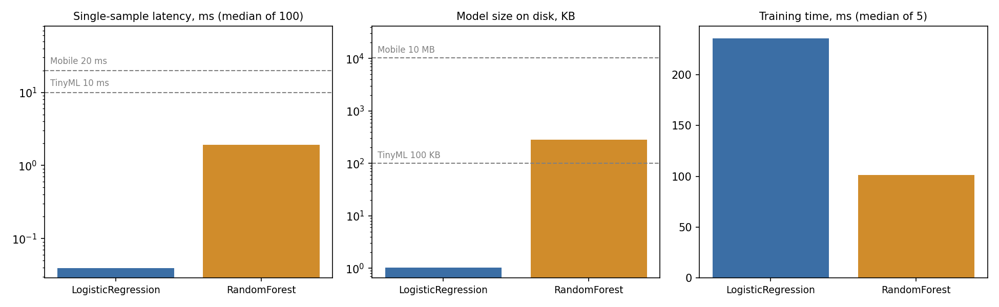

# Lab 1: Environment and first system measurements

## Goal

The goal of this lab was to set up a clean Python environment and to see how much two simple models
actually "cost" to run, not only how accurate they are. I trained Logistic Regression and Random Forest
on the Breast Cancer Wisconsin dataset, measured time, memory and model size, and then checked where
each model could be deployed (Cloud, Edge, Mobile, TinyML).

## Method

I created a venv with Python 3.11.8 and installed the pinned versions from `requirements.txt`.
The script `src/print_versions.py` saves all versions to `results/versions.txt`.

One thing did not work out of the box: pip could not install the requirements because `mlflow==2.14.1`
needs `pyarrow` lower than 16, but the list asks for `pyarrow==16.1.0`. I changed only pyarrow to
15.0.2, everything else is exactly as required.

Setup:

- Data: `load_breast_cancer`, 569 samples, 30 features. Split 70/30, stratified, `random_state=42`
  (398 train, 171 test).
- Models: `LogisticRegression(max_iter=1000, random_state=42)` and
  `RandomForestClassifier(n_estimators=100, random_state=42)`.
- All seeds are 42.
- Training time: one warm-up run, then 5 runs, I report the median.
- Latency: prediction for one sample, one warm-up, then 100 runs, median.
- Model size: saved with `joblib.dump`, size of the file.
- Memory: I used psutil and checked the process RSS every 1 ms in a separate thread during training
  and during inference. This is memory of the whole Python process, not only the model.
- Machine: Intel64 Family 6 Model 151 Stepping 5, GenuineIntel, 12 logical CPUs, 16 GB RAM, Windows.

With raw (unscaled) features LogReg hit the 1000 iteration limit and sklearn gave a ConvergenceWarning. I left the settings as in the task, but a StandardScaler would probably fix it and make training faster.

The code is in `src/run_lab01.py`, all outputs are in `results/`.

## Results

| Model | Accuracy | Train time, ms | Latency, ms | Size, bytes | Size, KB | Peak RAM train, MB | Peak RAM inference, MB |
|---|---|---|---|---|---|---|---|
| LogisticRegression | 0.9415 | 235.9 | 0.039 | 1,055 | 1.03 | 290.6 | 290.7 |
| RandomForest | 0.9357 | 101.3 | 1.902 | 290,889 | 284.07 | 291.1 | 291.1 |

During training and inference the memory grew by less than 1 MB. Almost all of the
~291 MB is just Python with numpy, scipy and sklearn loaded.

Deployment check (a model fits only if memory, latency and size are all inside the budget):

| Target | Memory | Latency | Model size | LogReg | Random Forest |
|---|---|---|---|---|---|
| Cloud | >= 1 GB | <= 100 ms | <= 500 MB | yes | yes |
| Edge | 256-1024 MB | <= 50 ms | <= 50 MB | yes | yes |
| Mobile | 64-256 MB | <= 20 ms | <= 10 MB | no (memory) | no (memory) |
| TinyML | <= 256 KB | <= 10 ms | <= 100 KB | no (memory) | no (memory, size) |

Where can each model run:

- Cloud and Edge are no problem for both models. Even the forest predicts in
  1.9 ms, while the limit is 50 ms for Edge. On something like a
  Raspberry Pi it will be slower than on my laptop, but there is still a lot of room.
- Mobile: on my machine neither fits, mostly because of memory: the Python process is ~291 MB and the limit is 256 MB. Random Forest is closer to
  the limits, its latency is about 48x higher and the file is about 276x bigger.
  Also, nobody runs a full Python on a phone, so in real life the model would be exported to something
  like ONNX.
- TinyML: neither model fits as I measured it, because 256 KB of memory is nothing compared to the
  ~291 MB Python process. But LogReg itself is only 30 weights and one bias, so if I rewrote the
  prediction in C it would easily fit on a microcontroller. Random Forest is out anyway, the file alone is 284 KB, more than the 100 KB limit.

So my decision: LogReg can go to Cloud, Edge (and TinyML after porting to C),
Random Forest to Cloud, Edge.

## Conclusions

1. The accuracy of both models is almost the same, Logistic Regression is better only by 0.58
   percentage points (0.9415 vs 0.9357). But the price is very
   different: the forest is about 48x slower on one prediction and about 276x
   bigger. Surprisingly, the forest trained faster (101 ms vs 236 ms). I think this is because LogReg runs all 1000 iterations on unscaled data. For a small table dataset like this I would choose LogReg.

2. What surprised me most is memory. The models themselves add almost nothing, but Python with the
   libraries already takes ~291 MB. So when we decide where to deploy, we need to look at the whole
   runtime, not only at the model file. This is the reason TinyML is impossible here, not the models.

3. Timing needs repeated runs. My training times jumped from 220 to
   261 ms for LogReg and from 96 to
   104 ms for the forest between runs. If I took just one run, I could
   easily get wrong conclusions, so warm-up and median really make sense.
