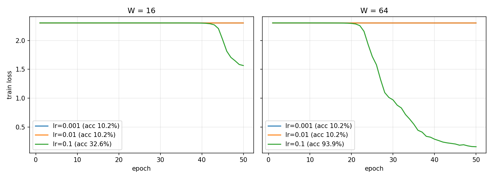

# Lab 2: Neural network from scratch

Code: `src/lab02.py` (NumPy only). Run on Kaggle. Results: `results/results.txt`, `results/loss_curves.png`.

## 1. Data
load_digits, 1797 images 8x8 (64 features). Inputs divided by 16, labels one-hot.
Stratified split 70/30, random_state=42: 1257 train, 540 test.

## 2. Network design
64 -> W -> ReLU -> W -> ReLU -> 10 -> softmax, W = 16 and W = 64.

| Layer | Weights | Bias |
|---|---|---|
| 1 | (64, W) | (W,) |
| 2 | (W, W) | (W,) |
| 3 | (W, 10) | (10,) |

Each layer: Z = A W + b. Weights from N(0, 0.01), biases 0.
Number of parameters: 1482 for W = 16, 8970 for W = 64.

## 3-4. Forward pass and loss
Output shape (32, 10), every row sums to 1 (max error 2.2e-16).
Untrained loss 2.3026 = ln(10), because all classes get probability about 0.1.

## 5. Gradients
Chain rule, from the output back:
- softmax + cross-entropy: dZ3 = (P - Y) / B
- linear layer: dW = A^T dZ, db = sum of dZ over the batch, dA_prev = dZ W^T
- ReLU: dZ = dA * (Z > 0)

Gradient check on the trained network (W = 64, lr = 0.1), 32 samples, h = 1e-5:
10/10 weights have relative error < 1e-6 (max 2.7e-8).

## 6. Training
Shuffle each epoch, batch 32, 50 epochs, SGD.

| W | lr | final loss | test accuracy |
|---|---|---|---|
| 16 | 0.001 | 2.3026 | 10.19% |
| 16 | 0.01 | 2.3026 | 10.19% |
| 16 | 0.1 | 1.5656 | 32.59% |
| 64 | 0.001 | 2.3025 | 10.19% |
| 64 | 0.01 | 2.3025 | 10.19% |
| 64 | 0.1 | 0.1594 | 93.89% |

With weights from N(0, 0.01) the outputs at the start are almost the same for all classes,
so gradients are very small. Only lr = 0.1 is big enough to leave the 2.30 plateau in 50 epochs.
W = 64 learns faster than W = 16. Smaller learning rates stay at 10% (random guessing).

## 7. Timing (1257 samples, median of 100 runs)

| W | forward, ms | backward, ms | backward / forward |
|---|---|---|---|
| 16 | 0.893 | 1.115 | 1.25 |
| 64 | 2.009 | 5.034 | 2.51 |

Backward is slower. In the forward pass every layer does one matrix multiplication (A W).
In the backward pass it does two: A^T dZ for the weight gradient and dZ W^T to send the error
to the previous layer. So forward has 3 matrix multiplications and backward has 5.
The difference is bigger for W = 64 because the W x W layer becomes larger.
